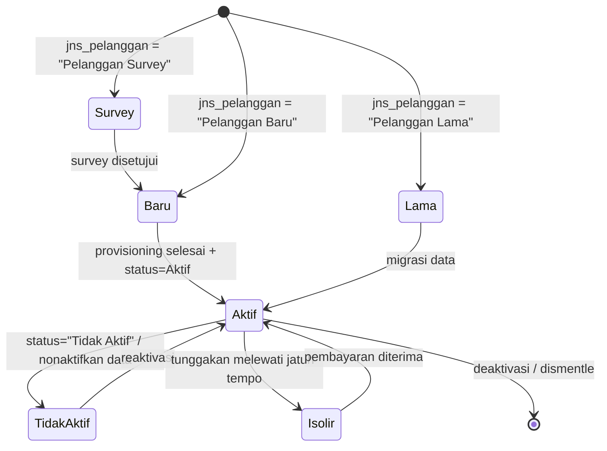
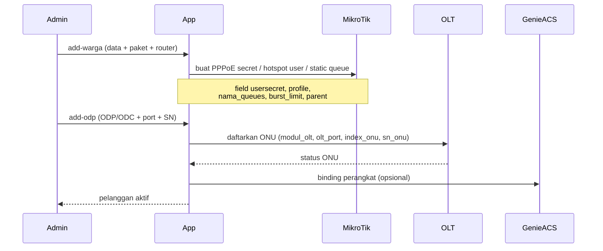
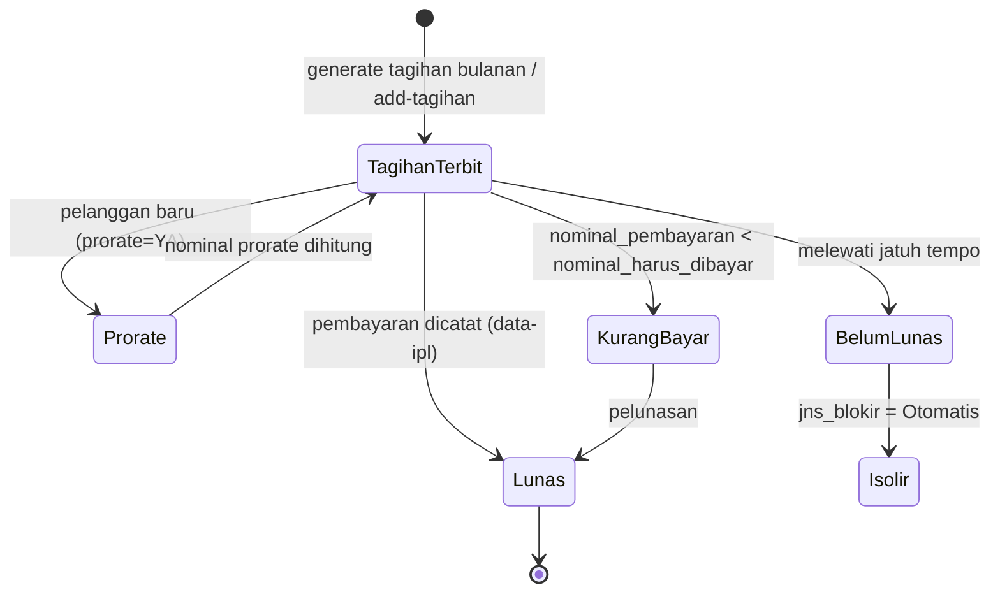
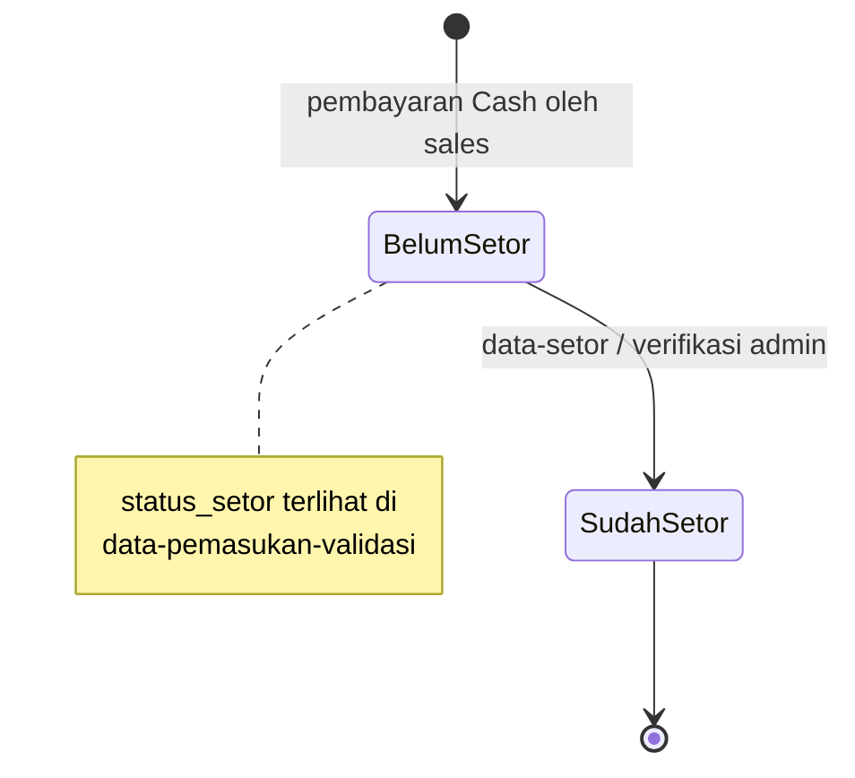
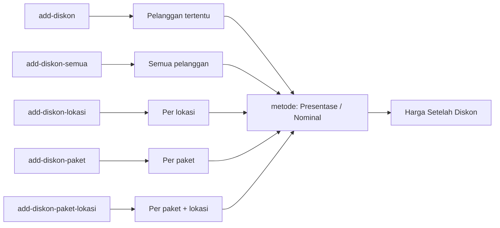
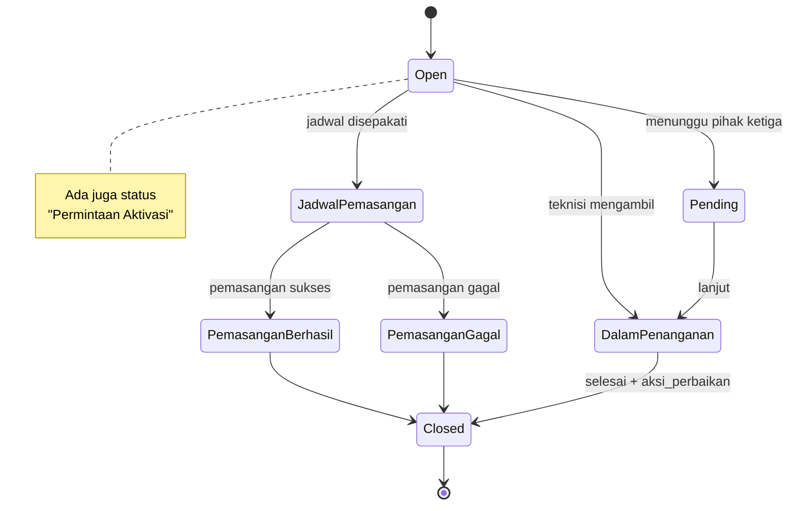
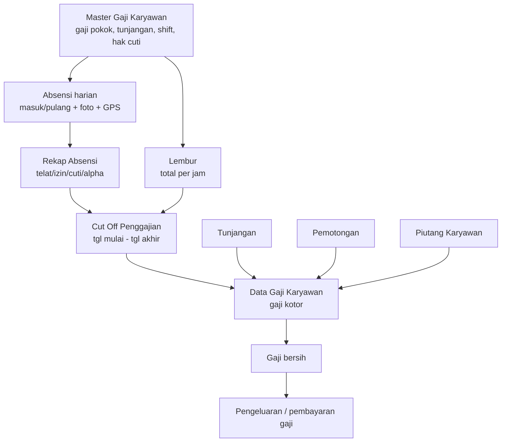
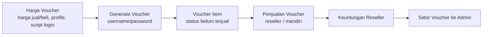
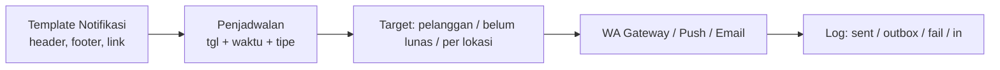

# Alur Bisnis & State Machine

Semua alur direkonstruksi dari halaman, form, tombol, dan enum yang ditemukan. Bagian yang diasumsikan ditandai *(asumsi)*.

---

## 1. Siklus hidup pelanggan

Bukti: `jns_pelanggan` (3 nilai) di `add-warga`; tombol **Nonaktifkan Data** dan halaman `data-pelanggan-tidak-aktif`; `data-isolir` (Static/PPPOE/Hotspot); `data-warga-status-koneksi` (Up/Down/Null).

**Aturan penomoran**: `id_pelanggan` diisi manual pada form (placeholder `id_pelanggan`), bukan auto-generate. Ada utilitas **Kode Unik** dan **Update KTP** massal.

---

## 2. Provisioning layanan

Bukti: `add-warga` memuat 17 field khusus MikroTik (7 slot router, `usersecret`, `profile`, `parent`, `burst_limit`, `nama_queues`) dan 5 field OLT/ONU; `data-odp` menyimpan relasi OLT/ODC/tiang/port; `data-genieacs-server` untuk TR-069; `data-installasi` menggabungkan pelanggan + OLT + ODP + ODC.

**Mode pembuatan** (`metode_pembuatan`): `Buat Baru` (provision dari app), `Sinkronisasi` (tarik dari router), `Manual`.

---

## 3. Siklus tagihan → pembayaran → setoran

Sub-alur setoran (tunai dari sales):

Bukti:
- `data-ipl`: `Nominal Harus Dibayar`, `Nominal Pembayaran`, `Status Pembayaran`, `Status Setor`, `Metode Pembayaran`, `Bukti Pembayaran`, `Periode Pembayaran`.
- `data-warga-kurang-bayar` (filter `tgl_jatuh_tempo`: 07/10/18/21/28 — jatuh tempo per tanggal klaster).
- `data-belum-bayar-prorate`: `Jumlah Hari Pemakaian` + `Nominal Pembayaran Prorate`.
- `data-setor`: rekap setoran per sales.
- `data-mutasi`: buku besar kredit/debit/saldo.
- `dashboard-income-summary`: rekap pemasukan per rekening/metode (Tunai, TRIPAY, XENDIT, MOOTA, PAKAR_DIGITAL, MESIN_OTOMATIS).

---

## 4. Diskon

Bukti: 5 form tambah diskon + kolom `Nama Diskon`, `Metode Diskon`, `Nominal Diskon`, `Harga Setelah Diskon`; tombol **Hapus Data Diskon Semua Pelanggan**. Diskon juga bisa menempel langsung ke tagihan manual (`add-tagihan` punya `jns_diskon`, `nominal_diskon`).

---

## 5. Deposit

Alur dua langkah: **pilih pelanggan** (`add-deposit-pelanggan&kode=1`) → form deposit. Dipakai untuk pembayaran di muka; tercatat sebagai `data-deposit-pelanggan` dengan status pembayaran, bukti, periode, dan metode.

---

## 6. Ticket / laporan pelanggan

Bukti: 8 status pada `edit-laporan-pelanggan-`; halaman terpisah per status (`open`, `pending`, `dalam-penanganan`, `closed`, `aktivasi`, `jadwal-pemasangan`); 20 jenis laporan (`jns_laporan`); field `kendala`, `aksi_perbaikan`, `foto`, `durasi`, dua teknisi (`id_teknisi5`, `id_teknisi6`); riwayat update tersimpan dengan `waktu_update` (tabel `TICKET_DETAIL`); `data-laporan-pelanggan-berita-acara` untuk BA pemasangan.

Jalur **Ticket General** terpisah (`add-laporan-general-`), tanpa pelanggan spesifik (`id_warga` = General/Project).

---

## 7. Payroll

Bukti: `data-gaji-karyawan` (20 kolom: hari kerja, izin, cuti, absen, tunjangan transport/makan, lembur, lain-lain, gaji kotor, pemotongan, gaji), `edit-cut-off-penggajian` (tgl mulai/akhir, bulan sama/berikutnya), `data-master-gaji-karyawan` (gaji pokok, tunjangan per hari, nominal lembur/jam, hak & sisa cuti), `data-absensi-karyawan` (shift, telat, durasi, foto, maps, jarak, max jarak), `data-lembur-karyawan` (checklist + **Setujui Terpilih**), `data-tunjangan`, `data-pemotongan`, `data-piutang-karyawan`.

Geofence absensi: `titik_koordinat_absensi_masuk/pulang` + `max_jarak` + `jarak` aktual.

---

## 8. Voucher & reseller

Bukti: `data-harga-voucher` (Nama, Harga Jual, Harga Beli, Profile, Lokasi, Router, Script On Login), `data-pemasukan-voucher` (username, password, waktu jual, bytes in/out, status), `data-setor-voucher-admin`, `data-user-reseller` (Level + Server Akses + Jumlah Stock Voucher), `jual-voucher-admin`, `dashboard-penjualan-voucher-mandiri`, `cek-voucher`.

Voucher terhubung ke MikroTik hotspot (`profile`, `script_on_login`) → penjualan memicu pembuatan user hotspot.

---

## 9. Poin pelanggan

`Pengaturan Poin` (ketentuan poin, mis. per pembayaran) → saldo poin pelanggan → `Pengaturan Hadiah` (stok) → `Pengajuan Penukaran` (status pengajuan + status pengambilan + foto + nama penyerah). Halaman penukaran untuk sisi pelanggan: `data-penukaran-hadiah-poin`.

---

## 10. Notifikasi & WhatsApp

Bukti: 15 template di `data-notifikasi`; `setting-push-notifikasi`; `data-wa` (WAGW server, 7 server, status Disconnected); `data-sent`, `data-outbox`, `data-fail`, `data-in`, `data-group`, `data-group-telegram`, `data-api-whatsapp-gateway`, `data-virtual-assistant`, `edit-mail-server` (SMTP); `data-blast`; `kirim-tagihan-belum-bayar-multi-manual` (endpoint kirim massal, tidak dieksekusi).

---

## 11. RBAC (24 level)

| Kelompok | Level |
|---|---|
| Pemilik / pusat | Administrator, Investor, Investor Cabang, Admin Pusat |
| Manajemen | Kepala Cabang, Kepala Sales, Kepala Sales Cabang, Kepala Teknisi, Kepala Teknisi Cabang, HRD |
| Operasional | Admin Lokasi, Admin Cabang, Admin Gudang, NOC, CS, CS Cabang |
| Lapangan | Sales, Teknisi, Teknisi Lokasi, Teknisi Cabang |
| Mitra | Reseller, Agen, Karyawan, Playstore User |

Menu yang tampil kemungkinan difilter per level (sidebar pada akun Administrator menampilkan semua). Detail matriks akses per level **belum** diverifikasi — perlu login sebagai role lain.

---

## 12. Isolir & status koneksi

- `data-isolir` menampilkan tab **Static / PPPOE / Hotspot** → isolir dilakukan per jenis koneksi.
- `data-warga-status-koneksi` memfilter `status_koneksi` = `Up` / `Down` / `Null`.
- `data-warga` punya aksi massal **Nonaktifkan Data** dan **Bayar Sekarang**.
- `validasi-status-langganan` (endpoint aksi, tidak dieksekusi) mengindikasikan sinkronisasi status On/Off antara app dan router.

*(asumsi)* Isolir otomatis dijalankan scheduler berdasarkan `tgl_jatuh_tempo` + `status_pembayaran` + `jns_blokir=Otomatis`.
